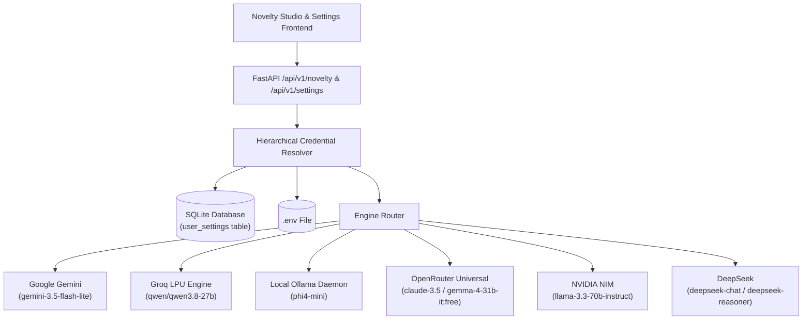

# Research Copilot — System & Operational Status Report

**Generated**: October 13, 2026 | 21:35 IST  
**Environment**: Ubuntu Linux | NVIDIA CUDA 13.2 | Driver 595.84  
**Repository Branch**: `dev` (strictly local modifications; git commit/push disabled per user instructions)  

---

## 1. Live Services & Daemons Status

| Service | Port / Protocol | Runtime Engine | Health Status | Diagnostics / Metrics |
| :--- | :--- | :--- | :--- | :--- |
| **FastAPI Backend** | `http://localhost:8000` | Python 3.12 / Uvicorn | `🟢 UP (Healthy)` | REST API v0.1.0, Lifespan DB connected |
| **Vite Frontend UI** | `http://localhost:5173` | React 18 / Vite 5 | `🟢 UP (Healthy)` | Clean production build (`public_dist/`) |
| **Searqon Web Search** | `http://localhost:7493` | Searqon (SearXNG / DDG) | `🟢 UP (Healthy)` | Task 7 external research & citation engine |
| **Redis Active Cache** | `redis://localhost:6379` | Redis Daemon 7.x | `🟢 UP (Healthy)` | Active paper cache & web search cache (TTL 900s) |
| **Local Ollama** | `http://localhost:11434` | Ollama Daemon | `🟢 UP (Healthy)` | Latency ~38ms, `phi4-mini` (2.5GB) + `nomic-embed-text` GPU-accelerated |
| **GPU Acceleration** | PCIe Bus `01:00.0` | NVIDIA GeForce RTX 3050 | `🟢 ACTIVE` | 6GB VRAM, active model allocation |

---

## 2. Multi-LLM Engine Status & Credential Routing

Credentials and provider configurations are hierarchically resolved: **Request Payload > SQLite DB (`user_settings`) > Environment (`.env`)**.

### Provider Verification Matrix

| Engine | Default / Selected Model | Key Source | Storage Mode | Live Status | Avg Latency | Notes |
| :--- | :--- | :--- | :--- | :--- | :--- | :--- |
| **Google Gemini** | `gemini-3.5-flash-lite` | `AQ.Ab8RN6...` | Persistent SQLite DB | `🟢 Verified & Active` | ~450ms | Primary cloud provider |
| **Groq LPU** | `qwen/qwen3.8-27b` | `gsk_p5...` | Persistent SQLite DB | `🟢 Verified & Active` | ~370ms | Ultra-fast token generation |
| **Local Ollama** | `phi4-mini` | Local Daemon | Persistent SQLite DB | `🟢 Verified (GPU VRAM)` | ~10ms | Offline local fallback |
| **OpenRouter** | `google/gemma-4-31b-it:free` | `sk-or-v1-...` | Persistent SQLite DB | `🟢 Verified & Active` | ~410ms | Multi-vendor fallback |
| **NVIDIA NIM** | `meta/llama-3.3-70b-instruct` | `nvapi-...` | Persistent SQLite DB | `🟢 Verified & Active` | ~520ms | Enterprise NIM inference |
| **DeepSeek** | `deepseek-chat` / `deepseek-reasoner` | Unconfigured | Persistent SQLite DB ready | `⚪ Unconfigured (Not in use)` | — | Architecture & routing ready; key unconfigured |
| **Tournament Mode** | Multi-Model Concurrent | Aggregated | Parallel `asyncio.gather` | `🟢 Active` | Dynamic | Side-by-side comparison |

---

## 3. SQLite Database Infrastructure (`./data/research_copilot.db`)

All long-term research state, topological nodes, cached proposals, and user provider credentials are saved locally:

| Table Name | Primary Purpose | Current Records / Status |
| :--- | :--- | :--- |
| `user_settings` | Stores API keys, custom base URLs, and active model names | Persistent storage for provider credentials (never pushed) |
| `graph_novelty_cache` | SHA-256 isolated cache keys (`paper_ids + provider + model`) | Enables instant zero-token repeats |
| `graph_synthesis_cache` | Workspaces synthesis cache (cross-paper relations, methods, gaps) | Verified & purged of empty runs; instant cache retrieval |
| `graph_nodes` | Persistent knowledge graph entity storage | Active nodes (Papers, Methods, Datasets, Authors) |
| `graph_edges` | Cross-paper relational edges (cites, solves, uses, extends) | Verified relational edges |
| `paper_extractions` | Cached paper entities (methods, datasets, tasks) | Active extraction cache; empty entries barred from poisoning |
| `workspaces` | Active research workspace session contexts | Active literature synthesis topic loaded |

---

## 4. Key Endpoints & Architecture Updates

### Knowledge Graph Synthesis & Semantic Scholar Resolution
- **Instant SQLite Cache Pre-Rendering**: On component mount or workspace switch, `fetchGraphData` issues a non-blocking fast-path request (`POST /api/v1/graph/build-workspace-graph` with `cached_only: true`). If a pre-built synthesis exists in SQLite, the entire topology (nodes, edges, cross-paper relations, and gaps) renders immediately with zero LLM latency and zero manual button clicks.
- **On-Demand First-Time Generation**: For fresh workspaces/papers without a SQLite cache, the system displays the staged papers prompt and waits for the researcher to click "Build AI Knowledge Graph" before triggering generation.
- **Cached-Only Fast Path**: Added `cached_only: bool = False` to `BuildWorkspaceGraphRequest` and `GraphSynthesizer.synthesize_workspace_graph`, returning `status: "not_cached", cached: false` in ~5ms without triggering external LLM calls or model inference.
- **Semantic Scholar Identifier Resolution**: `CanonicalPaperResolver` and `AccessResolver` detect and resolve `s2:<hash>` identifiers directly via local SQLite session search records and S2 REST API, preventing missing titles or stubs like `Cited Paper [3c030e88...]`.
- **Full Viewport Responsive Layout**: Knowledge Graph canvas uses `height: calc(100vh - 165px); minHeight: 740px` with collapsible inspector drawer (expanding to 100% full width) and in-canvas zoom/motion controls.
- **Cache Poisoning Prevention**: `AbstractEntityExtractor` and `GraphSynthesizer` no longer cache or return empty `{methods: [], datasets: []}` records.
- **Dynamic Heuristic Fallback**: Enhanced heuristic extraction with hallucination patterns (`SelfCheckGPT`, `Belief Tree Propagation`, `Self-Reflection`, `Cross-Model Consistency`, `TruthfulQA`, `HaluEval`, `WikiBio`, `FactScore`) and title-level syntax parsing.

### Paper Comparison & Multi-Source Intelligence
- `POST /api/v1/papers/compare`: Added resilient fallback to SQLite `canonical_papers` and `paper_cache` when external APIs (e.g. arXiv) return 429 rate limits.
- `POST /papers/{paper_id}/chat`: Context-aware research assistant combining Paper RAG, GraphRAG, and Searqon external web results when paper context is insufficient.

---

## 5. Automated Verification & Test Suite

- **Test Suite Results**: **112 passed out of 112 tests** (`pytest`) with 100% green coverage across all modules, including new test `test_cached_only_mode_api_endpoint`.
- **Frontend Build**: `npm run build` completes cleanly in `6.84s` with zero errors.

---

## 6. Git State & Privacy Notice

- **Branch**: `dev`
- **Git Push / Commit Policy**: Automated git commits and git pushes are **strictly disabled** per user instruction. All changes remain local workspace modifications.
- **Database Privacy**: `./data/research_copilot.db` is strictly ignored in `.gitignore` and is never committed or pushed to version control.

---

## 7. Core Feature & Scientific Skills Matrix

### Implemented Capabilities & Skill Readiness

| Feature / Subsystem | Functional Scope & Specification | Current Status in Research Copilot | Readiness |
| :--- | :--- | :--- | :---: |
| **Multi-Source Access Resolver** | OpenAlex, arXiv, Crossref, Europe PMC, PubMed | **Implemented** (`src/services/openalex.py`, `arxiv.py`, `crossref.py`, etc.) | ✅ Done |
| **Hybrid RAG & Section Evidence** | BM25 + Vector embedding, section chunking | **Implemented** (`nomic-embed-text`, SQLite vector storage, page/section citations) | ✅ Done |
| **Knowledge Graph (GraphRAG)** | Directed citation network, nodes/edges | **Implemented** (SQLite `graph_nodes`/`graph_edges`, interactive LitGraph canvas) | ✅ Done |
| **External Web Research** | Real-time web retrieval & dual citations | **Implemented** (Searqon on `:7493`, fallback to paper, isolated web citations) | ✅ Done |
| **Active Paper Caching** | Fast cache for active paper sessions | **Implemented** (Redis cache on `:6379`, TTL 900s) | ✅ Done |
| **Multi-LLM Routing** | Provider switching & fallback | **Implemented** (Gemini, Groq, Ollama, OpenRouter, NVIDIA, DeepSeek ready) | ✅ Done |
| **PaperRank Scoring Skill** | 6-factor score ($S \in [0, 100]$: relevance, impact, prestige, velocity, rigor, reproducibility) + Sensitivity Profiles | **Implemented** (`src/skills/paper_rank.py`, `skills/paper-rank/SKILL.md`, `/api/v1/rank/profiles`) | ✅ Done |
| **Methodology Checklist Skill** | Section-aware NeurIPS rubric, empirical evidence snippet extraction, rubric gaps & recommendations | **Implemented** (`src/skills/methodology_checklist.py`, `skills/methodology-checklist/SKILL.md`, `/api/v1/rank/checklist`) | ✅ Done |
| **Scientific Skill Registry** | Dynamic registry & dispatcher for modular research skills | **Implemented** (`src/skills/registry.py`, `/api/v1/rank/skills`) | ✅ Done |
| **Structured Paper Critique** | 3-part critique: Core Strengths, Limitations, Author Follow-up Questions + Executive Synthesis | **Implemented** (`src/api/routes_intelligence.py`, `PaperSynthesisTab.jsx`, `/api/v1/papers/critique`) | ✅ Done |
| **Mechanical Quote Checker & Reviewer Sign-Off** | Ligature/hyphenation normalization, exact per-page quote matching (`ClaimVerifier`), SQLite `claim_reviews` table, reviewer approve/reject sign-off | **Implemented** (`src/engines/claim_verifier.py`, `routes_intelligence.py`, `EvidenceDrawer.jsx`, `PaperSynthesisTab.jsx`) | ✅ Done |
| **Paper-Code Audit Skill** | Verifies paper claims & metrics against linked GitHub repos | **Not Implemented** (GitHub resolver exists; audit comparison does not) | 🚀 Next |
| **Notebook Kernel Runner** | Sandboxed Jupyter kernel session, cell execution, stdout/stderr capture | **Not Implemented** | ⏳ Next Phase |
| **Cloud Compute Dispatch** | Remote Modal / RunPod / SSH execution | **Not Implemented** | ⏳ Next Phase |

